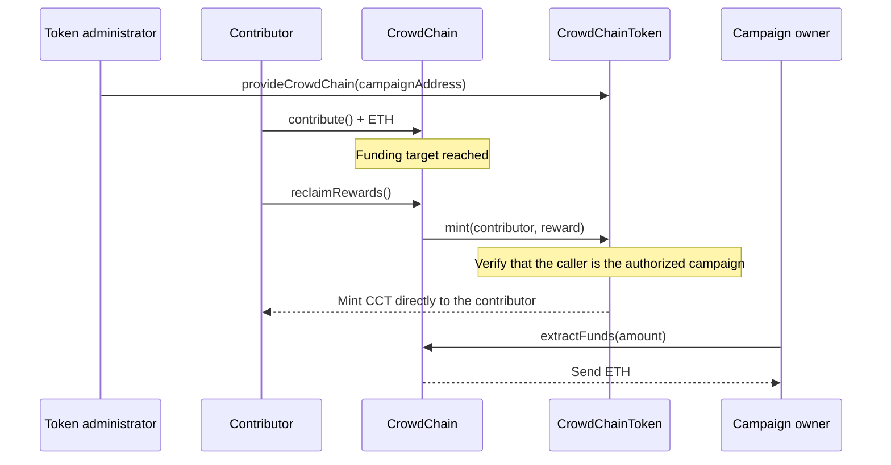

# CrowdChain

An Ethereum crowdfunding project with ERC-20 rewards, built with Solidity, OpenZeppelin Contracts, and Foundry.

Contributors fund a campaign with ETH. Once its funding target is reached, the campaign owner can withdraw the funds and contributors can claim CCT tokens proportional to their contributions. If the deadline arrives before the target is reached, contributors can recover their ETH.

This portfolio project explores campaign lifecycle rules, ETH transfers, interactions between contracts, restricted token issuance, and automated testing.

## Features

- One crowdfunding campaign per `CrowdChain` deployment.
- Configurable campaign owner, funding target, and duration, with a minimum duration of one day.
- Multiple contributions per wallet, tracked cumulatively.
- A funding cap: contributions that would exceed the target are rejected in full.
- Campaign closure when the target is reached or the deadline expires.
- Owner-only partial withdrawals after a successful campaign.
- Individual refunds after an unsuccessful campaign.
- CCT rewards minted on demand, with one claim per contributor.
- Custom errors for validation and access control.

## Campaign lifecycle

| State | Condition | Available actions |
| --- | --- | --- |
| Active | Before the deadline and below the target | Contribute ETH |
| Successful | The funding target has been reached | Owner withdraws ETH; contributors claim CCT |
| Failed | The deadline has arrived without reaching the target | Contributors recover their ETH |

The campaign closes immediately when its target is reached; participants do not have to wait for the original deadline to withdraw funds or claim rewards. Contributions are rejected at and after the deadline.

Withdrawals and token claims are independent. Owner withdrawals do not reduce the historical amount raised or contributors' reward entitlements.

## Contracts and interactions



### `CrowdChain.sol`

Holds the campaign's ETH, tracks contributions, and enforces campaign state transitions.

| Function | Purpose |
| --- | --- |
| `contribute()` | Send ETH to an active campaign |
| `extractFunds(amount)` | Withdraw available ETH as the owner after success |
| `recoverFunds()` | Recover the caller's contribution after failure |
| `reclaimRewards()` | Claim the caller's CCT reward after success |
| `completedWithSuccess()` | Check whether the funding target has been reached |
| `moneyToCompleteTarget()` | Read the amount still needed to reach the target |
| `remainingTime()` | Read the time remaining; returns zero after closure |

Public getters expose individual contributions, claim status, the amount withdrawn by the owner, and the reward conversion rate.

### `CrowdChainToken.sol`

An ERC-20 token based on OpenZeppelin's implementation.

| Property | Value |
| --- | --- |
| Name | CrowdChain Token |
| Symbol | CCT |
| Decimals | 18 |
| Reward rate | 100 CCT per ETH contributed |
| Initial supply | 0 |
| Authorized issuer | The address configured through `provideCrowdChain()` |

Only the token owner can configure the issuer, and only that issuer can call `mint`. The token owner and campaign owner are separate responsibilities, even when assigned to the same wallet.

Tokens are created directly in the contributor's wallet when a reward is claimed. The campaign does not need a token reserve or an ERC-20 allowance.

For example, a cumulative contribution of **0.5 ETH** earns **50 CCT**. Contributions are stored in wei and token balances use 18 decimal places, so the reward in token base units is `contributionInWei * 100`.

## Getting started

### Prerequisites

- Git, including submodule support.
- Foundry, with `forge` available in your terminal.
- A Solidity compiler compatible with `^0.8.34`; Foundry can download it when needed.

The project was locally verified with Foundry **1.8.6** and Solidity **0.8.37**. A first build may require network access to download the compiler.

### Install dependencies

After cloning this repository, run the following from its root directory:

```sh
git submodule update --init --recursive
```

The Git submodules provide `forge-std` and OpenZeppelin Contracts. Import remappings are included in the repository.

### Build and test

```sh
forge build
forge test -vv
```

Run an individual test or inspect its execution trace:

```sh
forge test --match-test testReclaimRewardsSuccess -vvvv
```

Generate coverage and gas reports:

```sh
forge coverage
forge test --gas-report
```

### Deployment configuration

Both contracts must be deployed and connected in this order:

1. Deploy `CrowdChainToken(owner_)`, using a nonzero administrator address.
2. Deploy `CrowdChain(owner_, token_, moneyTarget_, duration_)` with the token address, a nonzero campaign owner, a positive target in **wei**, and a duration of at least **86,400 seconds**.
3. As the token administrator, call `provideCrowdChain(campaignAddress)` on the token.

The setup is demonstrated in `test/CrowdChainTest.t.sol`. Rewards cannot be minted until the campaign is authorized. The repository currently contains no deployment script or published deployment addresses.

## Testing

The current suite contains **30 passing tests** across two test contracts:

| Suite | Tests | Behaviors exercised |
| --- | --- | --- |
| `CrowdChainTest` | 25 | Deployment validation, contributions, owner access, withdrawals, refunds, campaign outcome, remaining funding, and reward claims |
| `CrowdChainTokenTest` | 5 | Issuer configuration, administrator access, rejection of minting before issuer configuration, and authorized minting |

The tests use Foundry cheatcodes to simulate callers, fund wallets, advance time, and force failed ETH transfers. Assertions check custom errors and selected balance or accounting changes.

The suite does not yet cover every boundary or interaction. Further cases include multiple contributors, fractional and repeated contributions, claims after complete ETH withdrawal, deadline boundaries, and unauthorized minting after issuer configuration. Passing tests do not imply complete coverage or a security audit.

## Design and current limitations

- ETH withdrawals, refunds, and reward claims update their accounting before making external calls. A reverting external call rolls back those updates.
- Rewards depend on historical contributions, rather than the contract's current ETH balance.
- **The token administrator can currently replace the authorized issuer.** This is a trust assumption: changing it can block the original campaign's claims or authorize another address to mint.
- The token constructor currently accepts a zero owner address, which would prevent issuer configuration. Deployment must use a nonzero administrator.
- This is an educational project without a frontend, staking, or a factory for multiple campaigns. It has not been independently audited and is not presented as ready for real funds.

## Project structure

```text
CrowdChain/
├── src/
│   ├── CrowdChain.sol
│   └── CrowdChainToken.sol
├── test/
│   ├── CrowdChainTest.t.sol
│   └── CrowdChainTokenTest.t.sol
├── lib/                      # Git submodules
├── .github/workflows/test.yml
├── foundry.toml
├── foundry.lock
├── remappings.txt
└── README.md
```

## Development checks

The GitHub Actions workflow is configured to check formatting, build the contracts, and run the tests on pushes and pull requests.

```sh
forge fmt --check
forge build --sizes
forge test -vvv
```

At the time of this README update, all 30 tests pass locally, while `forge fmt --check` reports formatting differences. Those differences need to be resolved for the formatting step of CI to pass.

## Learning outcomes

- Modeling campaign states and deadline boundaries.
- Tracking ETH contributions with mappings.
- Separating historical accounting from available funds.
- Implementing ERC-20 rewards through interactions between contracts.
- Distinguishing token administration from minting permissions.
- Testing success paths, custom errors, and payment failures with Foundry.

## License

The project contracts currently use the SPDX identifier `UNLICENSED`; no open-source license is granted by this repository. Dependencies retain their respective licenses.
